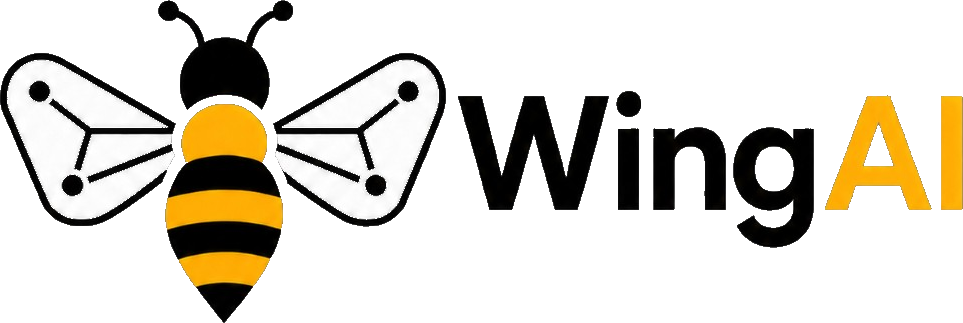
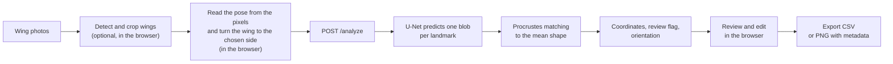

<p align="center">
  <picture>
    <source media="(prefers-color-scheme: dark)" srcset="./frontend/public/logo-dark.png">
    <source media="(prefers-color-scheme: light)" srcset="./frontend/public/logo.png">
    
  </picture>
</p>

<h1 align="center">WingAI</h1>

<p align="center">
  Automatic landmark detection on honey bee forewings<br>
  <a href="https://wingai.ii.pw.edu.pl"><strong>wingai.ii.pw.edu.pl</strong></a>
</p>

<p align="center">
  <a href="https://wingai.ii.pw.edu.pl"></a>
  <a href="LICENSE"></a>
  
  
  
  
</p>

<p align="center">
  <a href="#features">Features</a> ·
  <a href="#how-it-works">How it works</a> ·
  <a href="#using-the-application">Using the application</a> ·
  <a href="#getting-started">Getting started</a>
</p>

## About

**WingAI is a system for fully automatic detection of landmarks on the wings of the honey bee (*Apis mellifera*).** Drop in raw photos of wings and get back the numbered landmarks of every wing, ready for morphometric analysis.

An optional YOLO detector finds each wing in a photo and crops it, a U-Net places the 19 homologous landmarks of the forewing, and a Procrustes match to the mean wing shape numbers them, so that every point means the same thing in every wing of the sample. Wings in any pose can be mirrored and turned to one side, wings that need a second look are flagged, and any point can be corrected by hand. Results are exported as a CSV or as PNG images with the landmarks embedded for IdentiFly.

WingAI runs online at **https://wingai.ii.pw.edu.pl**, with no installation and no account. This repository holds the application, so that you can also [run it on your own computer](#run-locally-with-docker). It was built for the Warsaw University of Technology. Model training and evaluation live in the [bees](https://github.com/mkrajew/bees) repository.

## Features

- **Batch upload.** Drop `.png` and `.jpg` photos into the page and process them together.
- **Wing detection (optional).** A YOLO detector runs in your browser through ONNX Runtime Web. It finds each wing as a rotated box and crops it, turned so that the wing lies horizontal. A photo with several wings is split into separate images. Each image has skip, flip and rotate controls.
- **Two landmark models.** `precise` reads wings that lie upright with their base on the right. `rotation` handles wings in any pose. A switch in the header selects the model.
- **Orientation.** Pick a side and WingAI turns every wing to it, upright. It mirrors wings of the other handedness and turns wings that lie upside down, so a whole sample consists of left wings or of right wings, all in the same pose. The browser reads how a wing lies from the pixels of its picture and turns the picture before the backend sees it. This is what lets the `precise` model work with the right orientation. A wing whose pose the pixels do not show with confidence is left as it is. With the `rotation` model the answer of the backend is still checked afterwards. Keeping the original orientation changes nothing.
- **Review flag.** The backend flags wings with a wrong number of detected points, a failed match, or a large deviation from the mean wing shape.
- **Interactive review.** Drag any landmark, zoom, pan, rename or delete images, and move between images with the keyboard.
- **Export.** Download a CSV with the coordinates, a ZIP of PNG images with the landmarks embedded for IdentiFly, or both.
- **Interface.** English and Polish, light and dark theme.
- **Privacy.** The backend keeps no copy of uploaded images. It analyses each image during its request and discards it when the request ends.

## How it works



1. The browser can detect each wing with the YOLO model and crop it, turned to horizontal. This step is optional. After the first download, the model file stays in the browser cache.
2. When you choose a side, the browser reads the pose of each wing from the pixels of its picture and turns the picture to that side, upright (see below). A picture whose pose is not read with confidence is left as it is.
3. The browser uploads an image to `POST /analyze`. The backend fits it into a 400 x 400 input, and a U-Net predicts one blob per landmark. The blob centres become coordinates in the original image.
4. The blobs arrive in no fixed order. The backend aligns them to a mean wing shape with Procrustes analysis, which gives each point its landmark number.
5. The same alignment shows whether the wing has the handedness of the mean shape (`right`) or is its mirror image (`left`), and whether it lies upside down. With the `rotation` model the app checks this against the chosen side and turns a wing that is still wrong, together with its landmarks. The `precise` model gets no such correction.
6. You review the points in the browser and export them.

### Reading the pose from pixels

A wing cropped by the detector lies in one of four poses: a right or a left wing, upright or upside down. The app shrinks the picture to 256 x 96 gray pixels, builds histograms of the directions of its gradients in a grid of 16 x 6 cells, and compares them with the average wing in each of the four poses (made from the complete wings of 13 countries). The best pose wins, and it is trusted when it beats the second best by a margin of 0.10. The step takes about 25 ms for a crop of 2200 x 950 pixels.

Among 5 104 well cut wings that the detector found in all four poses (real photos, and wings of databases put on a canvas like a photo) it made no mistake, and the smallest margin of a right answer was above 0.3. A wing that is only a fragment, cut by the border of the photo, can be read confidently wrong. The `rotation` model corrects that after the answer. On wings turned to the right, the `precise` model finds the manual landmarks more accurately than the `rotation` model, by 0.3 px on average, in a test on 745 wings that the models did not see in training.

## Using the application

1. Open the page and drop your wing photos.
2. Optional: open **Detection model** in the header, click **Load model**, and click **Detect**. Every photo shows its boxes as soon as it is done, also in an open preview. Open a preview to choose the box that the app crops, or click **Extract wings** to split a photo with several wings.
3. Pick the **Model** and the **Orientation** in the header. The `precise` model works with the original orientation and with the orientation to the right. To orient the wings to the left, use the `rotation` model.
4. Click **Process**. The button is grey while the photos are still getting their thumbnails (a small spinner shows it) and while Detect runs, and it becomes active by itself.
5. Check the results. Wings flagged for review appear in a list at the top. Drag a point to move it.
6. Click **Generate data** and download the CSV, the ZIP, or both.

The **Help** button in the header lists the keyboard shortcuts.

## Output

**CSV** (`points.csv`): one row per image with the columns `file, x1, y1, ..., x19, y19`. The coordinates are pixels, rounded to integers and counted from the bottom-left corner of the image.

**PNG with metadata** (`image-metadata.zip`): the processed images, saved as `*.dw.png`. Each image carries its landmarks in a PNG text chunk with the key `IdentiFly` and the value `landmarks:x1 y1 x2 y2 ...;`. These coordinates are integer pixels counted from the top-left corner. When you tick both export options, the ZIP includes `points.csv`.

## Getting started

### Requirements

- **Docker** with Compose (Docker Desktop on Windows and macOS), to run WingAI in containers.
- **Python 3.13** with [uv](https://docs.astral.sh/uv/), and **Node.js 20.19** or newer (22.18 or newer to run the tests), to work on the code, see [Development](#development).

No GPU is needed: the backend runs on the CPU.

### Run locally with Docker

WingAI can be self-hosted using Docker Compose.

Trained model weights are not distributed with this repository. Users must provide compatible model files before starting the application.

1. Clone the repository:

   ```bash
   git clone https://github.com/mkrajew/wingai-app.git
   cd wingai-app
   ```

2. Place the following files in `backend/models/`:

   - precise.ckpt
   - rotation.ckpt
   - mean_shape.pth

3. Optionally, place `detector.onnx` in `frontend/public/models/` to enable browser-based wing detection and cropping.

4. Start WingAI:

   ```bash
   docker compose up
   ```

5. Open http://localhost:8080

No environment variables, SSL certificates or additional configuration files are required for local deployment.

The models must be compatible with the architectures and preprocessing pipeline implemented in this repository. See the [`bees`](https://github.com/mkrajew/bees) repository for model training and evaluation.

The first build downloads the dependencies, PyTorch among them, and can take a few minutes. After a start the backend needs a moment to load the models, and until it is ready nginx answers `502` to the requests of the app.

To stop WingAI, press `Ctrl+C` or run `docker compose down`. Add `-d` to `docker compose up` to run it in the background. After you pull a new version, or add the detector later, run `docker compose up --build` to rebuild the images.

### Model files

| File | Folder | Purpose |
| --- | --- | --- |
| `precise.ckpt` | `backend/models/` | `precise` landmark model |
| `rotation.ckpt` | `backend/models/` | `rotation` landmark model |
| `mean_shape.pth` | `backend/models/` | mean wing shape for landmark matching |
| `detector.onnx` | `frontend/public/models/` | wing detector (optional) |

The files in these folders are git-ignored. The names above are the defaults. If your files are named differently, set their names in `.env` instead of renaming them, see [Configuration](#configuration). The backend loads the three files in `backend/models/` at startup and stops with an error when one is missing. It reads them once, so after you change them run `docker compose restart backend`. Without the detector, upload photos of single wings that are already cut. The frontend image copies `frontend/public/` into the site, so the detector has to be in place when the image is built. The weights come from the training pipeline in [bees](https://github.com/mkrajew/bees).

### Configuration

The defaults need no configuration. To change them, set the variables below in a `.env` file next to `compose.yaml` (the file is git-ignored; [`.env.example`](.env.example) is a template) or in your shell.

| Variable | Default | Meaning |
| --- | --- | --- |
| `WINGAI_HTTP_PORT` | `8080` | Port on your computer. |
| `WINGAI_HTTP_BIND` | `127.0.0.1` | Address that the port is published on. The default makes WingAI reachable from this computer only, `0.0.0.0` from the whole network. |
| `WINGAI_NGINX_CONF` | `./nginx.conf` | nginx configuration that is mounted into the proxy container. |
| `WINGAI_PRECISE_MODEL` | `precise.ckpt` | Name of the `precise` checkpoint in `backend/models/`. |
| `WINGAI_ROTATION_MODEL` | `rotation.ckpt` | Name of the `rotation` checkpoint in `backend/models/`. |
| `WINGAI_MEAN_SHAPE` | `mean_shape.pth` | Name of the mean wing shape file in `backend/models/`. |

After you change `.env`, run `docker compose up -d`: it re-creates the containers whose settings changed, while `docker compose restart` keeps the old values.

### Development

Start the backend:

```bash
cd backend
uv sync
uv run uvicorn main:app --port 8000
```

The API listens on `http://localhost:8000`, with interactive documentation at `/docs`.

The backend expects the model files under the default names from [Model files](#model-files). If yours are named differently, let uvicorn read the names from the `.env` file of the repository (it does not read `.env` by itself):

```bash
uv run uvicorn --env-file ../.env main:app --port 8000
```

Start the frontend in a second terminal:

```bash
cd frontend
npm ci
npm run dev
```

The dev server runs on `http://localhost:5173`. The app calls the backend under `/api`: the dev server forwards these requests to `http://127.0.0.1:8000` and removes the prefix, as nginx does in the Docker setup (see `server.proxy` in `frontend/vite.config.ts`). The model files are needed here too, see [Model files](#model-files).

`npm run lint` runs ESLint, `npm test` runs the unit tests (Node.js 22.18 or newer, which runs the TypeScript as it is, with no extra packages) and `npm run build` type-checks the app and the tests and builds the production bundle.

More detail is in [`backend/README.md`](backend/README.md), which also documents the API, and in [`frontend/README.md`](frontend/README.md).

## Repository layout

```
.
├── backend/              FastAPI service
│   ├── main.py           /analyze endpoint and model loading
│   ├── wings/            preprocessing, U-Net, Procrustes matching
│   └── models/           checkpoints (git-ignored)
├── frontend/             React and TypeScript app, built with Vite
│   ├── src/              components, utilities, translations
│   ├── tests/            unit tests (npm test) and the vectors they compare with
│   └── public/           logo, icons, detector model (git-ignored)
├── compose.yaml          Docker Compose stack: backend, frontend, nginx
├── nginx.conf            reverse proxy of the stack, plain HTTP
└── LICENSE               GNU General Public License v3.0
```

## Tech stack

| Area | Technology |
| --- | --- |
| Frontend | React 19, TypeScript, Vite, Bootstrap 5, ONNX Runtime Web |
| Backend | Python 3.13, FastAPI, PyTorch (CPU build), Lightning, OpenCV, SciPy, uv |
| Deployment | Docker Compose, nginx |

## Contributing

Report bugs and ideas through [GitHub Issues](https://github.com/mkrajew/wingai-app/issues).

## License

WingAI uses the [GNU General Public License v3.0](LICENSE).

## Author

Mateusz Krajewski ([@mkrajew](https://github.com/mkrajew)) created WingAI for the Warsaw University of Technology.
