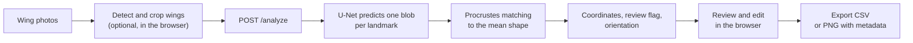

<p align="center">
  <picture>
    <source media="(prefers-color-scheme: dark)" srcset="./frontend/public/logo-dark.png">
    <source media="(prefers-color-scheme: light)" srcset="./frontend/public/logo.png">
    
  </picture>
</p>

<h1 align="center">WingAI</h1>

<p align="center">
  Automatic landmark detection on honey bee forewings<br>
  <a href="https://wingai.ii.pw.edu.pl"><strong>wingai.ii.pw.edu.pl</strong></a>
</p>

<p align="center">
  <a href="https://wingai.ii.pw.edu.pl"></a>
  <a href="LICENSE"></a>
  
  
  
  
</p>

## About

WingAI is a program for automatic detection of landmarks on honey bee forewings. It places the 19 landmarks on each wing photo, lets you check and correct them, and exports the results.

WingAI runs online at **https://wingai.ii.pw.edu.pl**. It needs no installation and no account. This repository holds the web application, built for the Warsaw University of Technology. Model training and evaluation live in the [bees](https://github.com/mkrajew/bees) repository.

## Features

- **Batch upload.** Drop `.png` and `.jpg` photos into the page and process them together.
- **Wing detection (optional).** A YOLO detector runs in your browser through ONNX Runtime Web. It finds each wing as a rotated box and crops it, turned so that the wing lies horizontal. A photo with several wings is split into separate images. Each image has skip, flip and rotate controls.
- **Two landmark models.** `precise` handles wings in their original, horizontal orientation. `rotation` handles rotated and mirrored wings. A switch in the header selects the model.
- **Orientation.** With the `rotation` model, WingAI mirrors wings of the other handedness, so a whole sample consists of left wings or of right wings.
- **Review flag.** The backend flags wings with a wrong number of detected points, a failed match, or a large deviation from the mean wing shape.
- **Interactive review.** Drag any landmark, zoom, pan, rename or delete images, and move between images with the keyboard.
- **Export.** Download a CSV with the coordinates, a ZIP of PNG images with the landmarks embedded for IdentiFly, or both.
- **Interface.** English and Polish, light and dark theme.
- **Privacy.** The backend keeps no copy of uploaded images. It analyses each image during its request and discards it when the request ends.

## How it works



1. The browser can detect each wing with the YOLO model and crop it, turned to horizontal. This step is optional. After the first download, the model file stays in the browser cache.
2. The browser uploads an image to `POST /analyze`. The backend fits it into a 400 x 400 input, and a U-Net predicts one blob per landmark. The blob centres become coordinates in the original image.
3. The blobs arrive in no fixed order. The backend aligns them to a mean wing shape with Procrustes analysis, which gives each point its landmark number.
4. The same alignment shows whether the wing has the handedness of the mean shape (`right`) or is its mirror image (`left`). The app uses this to orient a whole sample.
5. You review the points in the browser and export them.

## Using the application

1. Open the page and drop your wing photos.
2. Optional: open **Detection model** in the header, click **Load model**, and click **Detect**. Open a preview to choose the box that the app crops, or click **Extract wings** to split a photo with several wings.
3. Pick the **Model** and the **Orientation** in the header. The `precise` model needs the original orientation.
4. Click **Process**.
5. Check the results. Wings flagged for review appear in a list at the top. Drag a point to move it.
6. Click **Generate data** and download the CSV, the ZIP, or both.

The **Help** button in the header lists the keyboard shortcuts.

## Output

**CSV** (`points.csv`): one row per image with the columns `file, x1, y1, ..., x19, y19`. The coordinates are pixels, rounded to integers and counted from the bottom-left corner of the image.

**PNG with metadata** (`image-metadata.zip`): the processed images, saved as `*.dw.png`. Each image carries its landmarks in a PNG text chunk with the key `IdentiFly` and the value `landmarks:x1 y1 x2 y2 ...;`. These coordinates are integer pixels counted from the top-left corner. When you tick both export options, the ZIP includes `points.csv`.

## Getting started

### Requirements

- Production: Docker with Compose
- Development: Python 3.13 with [uv](https://docs.astral.sh/uv/), and Node.js 20.19 or newer

### Model files

The trained weights are not part of the repository, and the folders that hold them are git-ignored. Add them before you start:

| File | Folder | Purpose |
| --- | --- | --- |
| `final-precise.ckpt` | `backend/models/` | `precise` landmark model |
| `final-rotation-2.ckpt` | `backend/models/` | `rotation` landmark model |
| `mean_shape.pth` | `backend/models/` | mean wing shape for landmark matching |
| `best-dota.onnx` | `frontend/public/models/` | wing detector (optional) |

The backend loads the three files in `backend/models/` at startup and stops with an error when one is missing. The weights come from the training pipeline in [bees](https://github.com/mkrajew/bees).

### Development

Start the backend:

```bash
cd backend
uv sync
uv run uvicorn main:app --port 8000
```

The API listens on `http://localhost:8000`, with interactive documentation at `/docs`.

Start the frontend in a second terminal:

```bash
cd frontend
npm ci
npm run dev
```

The dev server runs on `http://localhost:5173`. The app calls the backend under `/api`, and nginx strips that prefix in production. For development, add the same behaviour to `frontend/vite.config.ts`:

```ts
export default defineConfig({
  // ...existing options
  server: {
    proxy: {
      "/api": {
        target: "http://localhost:8000",
        rewrite: (path) => path.replace(/^\/api/, ""),
      },
    },
  },
});
```

`npm run lint` runs ESLint and `npm run build` type-checks and builds the production bundle.

### Production with Docker Compose

```bash
docker compose up -d --build
```

| Service | Role |
| --- | --- |
| `backend` | FastAPI on port 8000, mounts `./backend/models` |
| `frontend` | The built app, served by nginx |
| `nginx` | Reverse proxy on ports 80 and 443. It forwards `/` to the frontend and `/api/` to the backend. |

Put `best-dota.onnx` into `frontend/public/models/` before you build the frontend image. The build copies it into the site.

The included `nginx.conf` and the certificate mount (`/etc/ssl/IIPW`) belong to the wingai.ii.pw.edu.pl deployment. For another host, change `server_name`, the certificate paths and the certificate mount in `docker-compose.yml`.

## API

`GET /` returns a short JSON greeting and works as a health check.

`POST /analyze` takes `multipart/form-data`:

| Field | Type | Description |
| --- | --- | --- |
| `file` | file | Wing image, PNG or JPEG |
| `x_size` | integer | Width of the image in pixels |
| `y_size` | integer | Height of the image in pixels |
| `model` | string | `precise` or `rotation` (default `rotation`) |

```bash
curl -F "file=@wing.png" -F "x_size=700" -F "y_size=270" -F "model=rotation" \
  http://localhost:8000/analyze
```

```jsonc
{
  "coords": [190.24, 149.2, 208.42, 150.34], // shortened: a real response has 38 numbers
  "check": false,
  "orientation": "right"
}
```

- `coords`: 38 numbers (`x1, y1, ..., x19, y19`) in pixels of the uploaded image, with the origin at the top-left corner.
- `check`: `true` when a person should review the result.
- `orientation`: `left` or `right`, the handedness of the wing relative to the mean shape.

Errors: `422` for an empty or unreadable image, `500` when the analysis fails.

## Repository layout

```
.
├── backend/              FastAPI service
│   ├── main.py           /analyze endpoint and model loading
│   ├── wings/            preprocessing, U-Net, Procrustes matching
│   └── models/           checkpoints (git-ignored)
├── frontend/             React and TypeScript app, built with Vite
│   ├── src/              components, utilities, translations
│   └── public/           logo, icons, detector model (git-ignored)
├── docker-compose.yml    production stack
└── nginx.conf            reverse proxy and TLS
```

## Tech stack

| Area | Technology |
| --- | --- |
| Frontend | React 19, TypeScript, Vite, Bootstrap 5, ONNX Runtime Web |
| Backend | Python 3.13, FastAPI, PyTorch (CPU build), Lightning, OpenCV, SciPy, uv |
| Deployment | Docker Compose, nginx |

## Contributing

Report bugs and ideas through [GitHub Issues](https://github.com/mkrajew/wingai-app/issues).

## License

WingAI uses the [GNU General Public License v3.0](LICENSE).

## Author

Mateusz Krajewski ([@mkrajew](https://github.com/mkrajew)) created WingAI for the Warsaw University of Technology.
