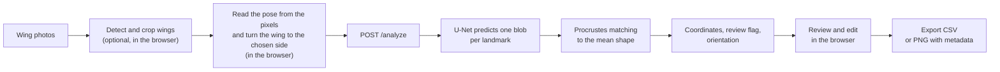
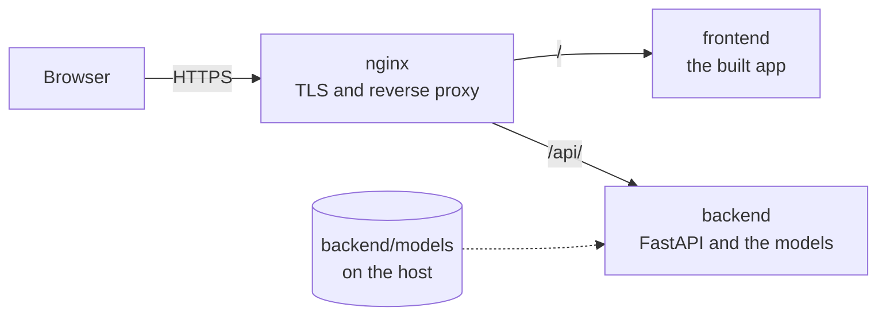

<p align="center">
  <picture>
    <source media="(prefers-color-scheme: dark)" srcset="./frontend/public/logo-dark.png">
    <source media="(prefers-color-scheme: light)" srcset="./frontend/public/logo.png">
    
  </picture>
</p>

<h1 align="center">WingAI</h1>

<p align="center">
  Automatic landmark detection on honey bee forewings<br>
  <a href="https://wingai.ii.pw.edu.pl"><strong>wingai.ii.pw.edu.pl</strong></a>
</p>

<p align="center">
  <a href="LICENSE"></a>
  
  
  
  
</p>

<p align="center">
  <a href="#features">Features</a> ·
  <a href="#how-it-works">How it works</a> ·
  <a href="#using-the-application">Using the application</a> ·
  <a href="#getting-started">Getting started</a> ·
  <a href="#development">Development</a> ·
  <a href="#deployment">Deployment</a> ·
  <a href="#api">API</a>
</p>

> 🌐 **WingAI is live:** https://wingai.ii.pw.edu.pl/  
> Open the web app in your browser — no local installation required.

<a href="https://wingai.ii.pw.edu.pl/" target="_blank">
  
</a>

---

**WingAI is a system for fully automatic detection of landmarks on the wings of the honey bee (*Apis mellifera*).** Drop in raw photos of wings and get back the numbered landmarks of every wing, ready for morphometric analysis.

The entire pipeline is automatic. A YOLO detector finds each wing in a photo and crops it, a U-Net places the 19 homologous landmarks of the forewing, and a Procrustes match to the mean wing shape numbers them, so that every point means the same thing in every wing of the sample. Wings in any pose can be mirrored and turned to one side, wings that need a second look are flagged, and any point can be corrected by hand. Results are exported as a CSV or as PNG images with the landmarks embedded for IdentiFly.

WingAI is built for high-throughput morphometrics: a whole sample is processed in one go, and the landmarks of a wing are predicted in about half a second on a laptop CPU.

This repository holds the whole application and its deployment: the React frontend, the FastAPI backend, the Docker Compose stack and the nginx configuration of the server at wingai.ii.pw.edu.pl, and the tools that check changes. The models were trained in the [bees](https://github.com/mkrajew/bees) repository. A version to run on your own computer, without the server setup, is published as [wingai-app](https://github.com/mkrajew/wingai-app).

## Features

- **Batch upload.** Drop `.png` and `.jpg` photos into the page and process them together.
- **Wing detection (optional).** A YOLO detector runs in your browser through ONNX Runtime Web. It finds each wing as a rotated box and crops it, turned so that the wing lies horizontal. A photo with several wings is split into separate images. Each image has skip, flip and rotate controls.
- **Two landmark models.** `precise` reads wings that lie upright with their base on the right. `rotation` handles wings in any pose. A switch in the header selects the model.
- **Orientation.** Pick a side and WingAI turns every wing to it, upright. It mirrors wings of the other handedness and turns wings that lie upside down, so a whole sample consists of left wings or of right wings, all in the same pose. The browser reads how a wing lies from the pixels of its picture and turns the picture before the backend sees it. This is what lets the `precise` model work with the right orientation. A wing whose pose the pixels do not show with confidence is left as it is. With the `rotation` model the answer of the backend is still checked afterwards. Keeping the original orientation changes nothing.
- **Review flag.** The backend flags wings with a wrong number of detected points, a failed match, or a large deviation from the mean wing shape.
- **Interactive review.** Drag any landmark, zoom, pan, rename or delete images, and move between images with the keyboard.
- **Export.** Download a CSV with the coordinates, a ZIP of PNG images with the landmarks embedded for IdentiFly, or both.
- **Interface.** English and Polish, light and dark theme.
- **Privacy.** The backend keeps no copy of uploaded images. It analyses each image during its request and discards it when the request ends.

## How it works



1. The browser can detect each wing with the YOLO model and crop it, turned to horizontal. This step is optional. After the first download, the model file stays in the browser cache.
2. When you choose a side, the browser reads the pose of each wing from the pixels of its picture and turns the picture to that side, upright (see below). A picture whose pose is not read with confidence is left as it is.
3. The browser uploads an image to `POST /analyze`. The backend fits it into a 400 x 400 input, and a U-Net predicts one blob per landmark. The blob centres become coordinates in the original image.
4. The blobs arrive in no fixed order. The backend aligns them to a mean wing shape with Procrustes analysis, which gives each point its landmark number.
5. The same alignment shows whether the wing has the handedness of the mean shape (`right`) or is its mirror image (`left`), and whether it lies upside down. With the `rotation` model the app checks this against the chosen side and turns a wing that is still wrong, together with its landmarks. The `precise` model gets no such correction.
6. You review the points in the browser and export them.

### Reading the pose from pixels

A wing cropped by the detector lies in one of four poses: a right or a left wing, upright or upside down. The app shrinks the picture to 256 x 96 gray pixels, builds histograms of the directions of its gradients in a grid of 16 x 6 cells, and compares them with the average wing in each of the four poses (made from the complete wings of 13 countries). The best pose wins, and it is trusted when it beats the second best by a margin of 0.10. The step takes about 25 ms for a crop of 2200 x 950 pixels.

Among 5 104 well cut wings that the detector found in all four poses (real photos, and wings of databases put on a canvas like a photo) it made no mistake, and the smallest margin of a right answer was above 0.3. A wing that is only a fragment, cut by the border of the photo, can be read confidently wrong. The `rotation` model corrects that after the answer. On wings turned to the right, the `precise` model finds the manual landmarks more accurately than the `rotation` model, by 0.3 px on average, in a test on 745 wings that the models did not see in training. [`tools/pose/REPORT.md`](tools/pose/REPORT.md) has the numbers.

## Using the application

1. Open the page and drop your wing photos.
2. Optional: open **Detection model** in the header, click **Load model**, and click **Detect**. Every photo shows its boxes as soon as it is done, also in an open preview. Open a preview to choose the box that the app crops, or click **Extract wings** to split a photo with several wings.
3. Pick the **Model** and the **Orientation** in the header. The `precise` model works with the original orientation and with the orientation to the right. To orient the wings to the left, use the `rotation` model.
4. Click **Process**. The button is grey while the photos are still getting their thumbnails (a small spinner shows it) and while Detect runs, and it becomes active by itself.
5. Check the results. Wings flagged for review appear in a list at the top. Drag a point to move it.
6. Click **Generate data** and download the CSV, the ZIP, or both.

The **Help** button in the header lists the keyboard shortcuts.

## Output

**CSV** (`points.csv`): one row per image with the columns `file, x1, y1, ..., x19, y19`. The coordinates are pixels, rounded to integers and counted from the bottom-left corner of the image.

**PNG with metadata** (`image-metadata.zip`): the processed images, saved as `*.dw.png`. Each image carries its landmarks in a PNG text chunk with the key `IdentiFly` and the value `landmarks:x1 y1 x2 y2 ...;`. These coordinates are integer pixels counted from the top-left corner. When you tick both export options, the ZIP includes `points.csv`.

## Getting started

### Requirements

- **Docker** with Compose, to run the production stack.
- **Python 3.13** with [uv](https://docs.astral.sh/uv/) and **Node.js 20.19** or newer, to work on the code. Node.js 22.18 or newer runs the tests.

No GPU is needed: the backend runs on the CPU.

### Model files

The trained weights are not part of the repository, and the folders that hold them are git-ignored. Create the folders if they do not exist and add the files before you start:

| File | Folder | Purpose |
| --- | --- | --- |
| `final-precise.ckpt` | `backend/models/` | `precise` landmark model |
| `final-rotation-2.ckpt` | `backend/models/` | `rotation` landmark model |
| `mean_shape.pth` | `backend/models/` | mean wing shape for landmark matching |
| `best-dota.onnx` | `frontend/public/models/` | wing detector (optional) |

The backend loads the three files in `backend/models/` at startup and stops with an error when one is missing. The detector is optional, but the production frontend image copies `frontend/public/` into the site, so the file has to be in place when the image is built. The weights come from the training pipeline in [bees](https://github.com/mkrajew/bees).

## Development

Start the backend:

```bash
cd backend
uv sync
uv run uvicorn main:app --port 8000
```

The API listens on `http://localhost:8000`, with interactive documentation at `/docs`.

Start the frontend in a second terminal:

```bash
cd frontend
npm ci
npm run dev
```

The dev server runs on `http://localhost:5173`. The app calls the backend under `/api`, and nginx strips that prefix in production. For development, add the same behaviour to `frontend/vite.config.ts`:

```ts
export default defineConfig({
  // ...existing options
  server: {
    proxy: {
      "/api": {
        target: "http://localhost:8000",
        rewrite: (path) => path.replace(/^\/api/, ""),
      },
    },
  },
});
```

`npm run lint` runs ESLint, `npm test` runs the unit tests (Node.js 22.18 or newer, which runs the TypeScript as it is, with no extra packages) and `npm run build` type-checks the app and the tests and builds the production bundle.

To check that a change does not alter what **Process** does, see the browser scripts in [`tools/regression`](tools/regression/README.md).

## Deployment

WingAI runs as three containers behind one nginx, started with Docker Compose.



| Service | Container | Role |
| --- | --- | --- |
| `backend` | `backend` | FastAPI on port 8000, not published. Mounts `./backend/models` from the host. |
| `frontend` | `frontend` | The built app, served by nginx inside the container on port 80, not published. |
| `nginx` | `nginx-proxy` | The only published service, on ports 80 and 443. It redirects HTTP to HTTPS and forwards `/` to the frontend and `/api/` to the backend, with the `/api` prefix removed. |

All three containers start again by themselves after a reboot of the host (`restart: unless-stopped`).

`nginx.conf` also sets what the application needs: uploads of up to 100 MB, request timeouts of 10 minutes on `/api/` for long batches, and the JavaScript MIME type for `.mjs` files, which the ONNX Runtime worker requires.

### First deployment

1. Install Docker with Compose on the host.
2. Clone the repository.
3. Add the model files (see above). Put `best-dota.onnx` into `frontend/public/models/` before the frontend image is built, because the build copies `frontend/public/` into the site.
4. Put the TLS certificate and its key into `/etc/ssl/IIPW` on the host, named `lotw.ii.pw.edu.pl.crt` and `lotw.ii.pw.edu.pl.key`. The folder is mounted read-only into nginx.
5. Start the stack:

   ```bash
   docker compose up -d --build
   ```

   The first build downloads the dependencies, PyTorch among them, and takes several minutes. After a start the backend needs a moment to load the models, and the site answers 502 until it is ready.

`nginx.conf` and the certificate mount belong to the wingai.ii.pw.edu.pl deployment. For another host, change `server_name`, the certificate paths and the certificate mount in `docker-compose.yml`.

### Updating the server

The server runs `main`. Depending on the user, the Docker commands may need `sudo`.

1. Pull the new version in the folder of the repository on the server:

   ```bash
   git pull
   ```

   If the update needs a new or changed model file, copy it into `backend/models/` or `frontend/public/models/` first. These folders are git-ignored, so `git pull` does not bring the files.

2. Rebuild the containers whose files changed. The output of `git pull` shows what changed. While an image builds, the running version keeps serving, and if the build fails nothing is replaced.

   | What changed | Command |
   | --- | --- |
   | `frontend/` | `docker compose up -d --build frontend` |
   | `backend/` | `docker compose up -d --build backend` |
   | `nginx.conf` | nothing to build, only step 3 |
   | only documents or `tools/` | nothing to rebuild |

3. Restart nginx. It looks up the addresses of the containers when it starts, so after a container was replaced it can still point at the old address and answer 502:

   ```bash
   docker compose restart nginx
   ```

4. Check that all three containers are `Up`, and process a few photos on the site (Ctrl+F5):

   ```bash
   docker compose ps
   ```

To go back, check out an earlier commit (`git checkout <commit>`) and repeat steps 2 and 3. `git checkout main` returns to the branch afterwards.

### Day to day

| Task | Command |
| --- | --- |
| State of the containers | `docker compose ps` |
| Follow a log | `docker compose logs -f backend` (or `frontend`, `nginx`) |
| Restart one service | `docker compose restart backend` |
| Stop everything | `docker compose down` |
| Start it again | `docker compose up -d` |

The backend loads its models once, at startup. After you change files in `backend/models/`, restart it with `docker compose restart backend`.

## API

`GET /` returns a short JSON greeting and works as a health check.

`POST /analyze` takes `multipart/form-data`:

| Field | Type | Description |
| --- | --- | --- |
| `file` | file | Wing image, PNG or JPEG |
| `x_size` | integer | Required, but not used: the backend measures the decoded image itself |
| `y_size` | integer | Required, but not used: the backend measures the decoded image itself |
| `model` | string | `precise` or `rotation` (default `rotation`) |

```bash
curl -F "file=@wing.png" -F "x_size=700" -F "y_size=270" -F "model=rotation" \
  http://localhost:8000/analyze
```

```jsonc
{
  "coords": [190.24, 149.2, 208.42, 150.34], // shortened: a real response has 38 numbers
  "check": false,
  "orientation": "right"
}
```

- `coords`: 38 numbers (`x1, y1, ..., x19, y19`) in pixels of the uploaded image, with the origin at the top-left corner.
- `check`: `true` when a person should review the result.
- `orientation`: `left` or `right`, the handedness of the wing relative to the mean shape.

Errors: `422` for an empty or unreadable image, `500` when the analysis fails.

## Tools

`tools/` holds measurements and checks. They are not part of the application and are not built into the images.

- [`tools/pose`](tools/pose/README.md): reading the pose of a wing from its pixels. How it was measured, the templates, the vectors that the unit tests compare with, and the [report](tools/pose/REPORT.md).
- [`tools/regression`](tools/regression/README.md): browser scripts that run the real flow of the app (upload, Detect, the backend, the review screen) and record what the backend receives and what the review shows, so that the same run before and after a change can be compared.

## Repository layout

```
.
├── backend/              FastAPI service
│   ├── main.py           /analyze endpoint and model loading
│   ├── wings/            preprocessing, U-Net, Procrustes matching
│   └── models/           checkpoints (git-ignored)
├── frontend/             React and TypeScript app, built with Vite
│   ├── src/              components, utilities, translations
│   ├── tests/            unit tests (npm test) and the vectors they compare with
│   └── public/           logo, icons and the detector in models/ (git-ignored)
├── tools/                measurements and checks, not part of the app
│   ├── pose/             reading the pose of a wing from its pixels: tests, report, template
│   └── regression/       browser scripts that compare what Process does before and after a change
├── docker-compose.yml    production stack
├── nginx.conf            reverse proxy and TLS
└── LICENSE               GNU General Public License v3.0
```

## Tech stack

| Area | Technology |
| --- | --- |
| Frontend | React 19, TypeScript, Vite, Bootstrap 5, ONNX Runtime Web |
| Backend | Python 3.13, FastAPI, PyTorch (CPU build), Lightning, OpenCV, SciPy, uv |
| Deployment | Docker Compose, nginx |

## Feedback

Report bugs and ideas through the Issues of this repository. People who run the version for their own computer report them in [wingai-app](https://github.com/mkrajew/wingai-app/issues).

## License

WingAI uses the [GNU General Public License v3.0](LICENSE).

## Author

Mateusz Krajewski ([@mkrajew](https://github.com/mkrajew)) created WingAI for the Warsaw University of Technology.
